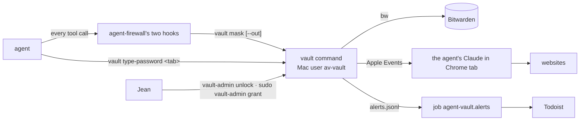

# agent-vault

The only door to Jean's Bitwarden: agents log in and make new passwords through it in their own Claude in Chrome tab, and no long-lived secret (a password, a card, AHV or IBAN number, a key) ever reaches what an agent is aware of. Rules and words for agents: [`AGENTS.md`](AGENTS.md); what Jean gets: [`REQUIREMENTS.md`](REQUIREMENTS.md); the design: [`DESIGN.md`](DESIGN.md); out of scope (rogue agents): [`CONSIDERATIONS.md`](CONSIDERATIONS.md).

Version 2, since the split of agent-interfaces (2026-11-23) its own repo, `agent-vault`, installable beside the live `layer-vault` (same code, new names): the switch is `doc/switch_from_layer.md`.

| Step | Command |
|---|---|
| test (fake `bw`, no sudo) | `bash /Users/jeanlescut/dev/agents/agent-vault/test/run_all.sh` |
| install, system part (Jean, sudo) | `sudo bash /Users/jeanlescut/dev/agents/agent-vault/install_system.sh [--from-layer]` |
| install, user part | `bash /Users/jeanlescut/dev/agents/agent-vault/install.sh [--stage]` |
| switch from layer-vault | `doc/switch_from_layer.md` |
| unlock (once installed) | `vault-admin unlock` |
| grant a session | `sudo vault-admin grant <session UUID> site:shop.ch --for 2h --can login,new-password` |
| who holds what | `vault-admin status` |
